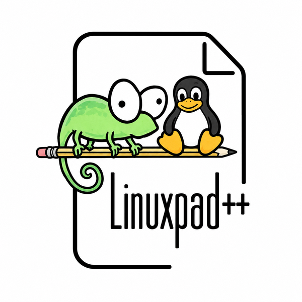

<p align="center"></p>

# LinuxPad++

LinuxPad++ is [Notepad++](https://notepad-plus-plus.org/) with a native Qt 6 interface for Linux. The editing
engine, the lexers, the languages, themes, translations and the menus are the ones of Notepad++; the Win32
user interface is replaced by Qt code (`PowerEditor/linux/src`), so it runs without Wine on any Linux desktop.

It has the features of Notepad++: tabs and split view, find and replace (with regular expressions, find in files
and in projects), macros, sessions and backups, user defined languages, function list, document map, project
panels, clipboard history, the shortcut mapper and the preferences. More than 50 Notepad++ plugins are ported,
on a plugin SDK that provides the Win32 API on Qt (`PowerEditor/linux/plugin-sdk`), so more can be ported.

LinuxPad++ is based on Notepad++ by Don Ho and the Notepad++ contributors. It is not an official Notepad++
release. The README of Notepad++ is [README.notepad-plus-plus.md](README.notepad-plus-plus.md).

## Get the source

```bash
git clone https://github.com/SkeletonSkelettron/linuxpad-plus-plus.git
```

## Build and install (Fedora)

```bash
sudo dnf install gcc-c++ cmake ninja-build python3 qt6-qtbase-devel qt6-qt5compat-devel pcre2-devel libxml2-devel
```

```bash
cmake -S PowerEditor/linux -B build-linux -G Ninja -DCMAKE_BUILD_TYPE=Release -DCMAKE_INSTALL_PREFIX="$HOME/.local"
```

```bash
cmake --build build-linux
```

```bash
cmake --install build-linux
```

The program is `linuxpad++`, with a LinuxPad++ entry in the applications menu. Optional at run time: `libxslt`
(XSL transformations of XML Tools), `libgit2` and `sqlite` (Git and SVN compares of ComparePlus),
`hunspell-*` dictionaries (DSpellCheck), the .NET 10 SDK at build time (JSONTools).
[PowerEditor/linux/README.md](PowerEditor/linux/README.md) has the details, the Flatpak build and the tests.

Settings are stored in `~/.config/linuxpad++/`. The first start copies the settings of `~/.config/notepad++/`
(the folder of the earlier builds of this port, which were called Notepad++) and leaves that folder as it is.

## Plugins

| Plugin | Folder | Upstream | License |
|---|---|---|---|
| Auto Detect Indention | [`nppAutoDetectIndent`](PowerEditor/linux/plugins/nppAutoDetectIndent) | [Chocobo1/nppAutoDetectIndent](https://github.com/Chocobo1/nppAutoDetectIndent) | GPL v3 or later |
| BetterMultiSelection | [`BetterMultiSelection`](PowerEditor/linux/plugins/BetterMultiSelection) | [dail8859/BetterMultiSelection](https://github.com/dail8859/BetterMultiSelection) | GPL v2 or later |
| Color Picker | [`NPPColorPicker`](PowerEditor/linux/plugins/NPPColorPicker) | [dasu88/NPPColorPicker](https://github.com/dasu88/NPPColorPicker) | no license upstream |
| ColumnTools | [`ColumnTools`](PowerEditor/linux/plugins/ColumnTools) | [vinsworldcom/nppColumnTools](https://github.com/vinsworldcom/nppColumnTools) | GPL v2 or later |
| Comment Toggler | [`CommentToggler`](PowerEditor/linux/plugins/CommentToggler) | [ScienceDiscoverer/CommentToggler](https://github.com/ScienceDiscoverer/CommentToggler) | GPL v3 |
| ComparePlus | [`ComparePlus`](PowerEditor/linux/plugins/ComparePlus) | [pnedev/comparePlus](https://github.com/pnedev/comparePlus) | GPL v3 |
| Diff Checker | [`DiffChecker`](PowerEditor/linux/plugins/DiffChecker) | [pnedev/comparePlus](https://github.com/pnedev/comparePlus) | GPL v3 |
| DSpellCheck | [`DSpellCheck`](PowerEditor/linux/plugins/DSpellCheck) | [Predelnik/DSpellCheck](https://github.com/Predelnik/DSpellCheck) | GPL v2 |
| EditorConfig | [`NppEditorConfig`](PowerEditor/linux/plugins/NppEditorConfig) | [editorconfig/editorconfig-notepad-plus-plus](https://github.com/editorconfig/editorconfig-notepad-plus-plus) | GPL v2 |
| Emoji Description | [`EmojiDescription`](PowerEditor/linux/plugins/EmojiDescription) | [Ruberoid/npp_emoji_description](https://github.com/Ruberoid/npp_emoji_description) | GPL v2 |
| Explorer | [`Explorer`](PowerEditor/linux/plugins/Explorer) | [oviradoi/npp-explorer-plugin](https://github.com/oviradoi/npp-explorer-plugin) | GPL v2 |
| Folding Line Hider | [`FoldingLineHider`](PowerEditor/linux/plugins/FoldingLineHider) | [leonardchai/FoldingLineHider](https://github.com/leonardchai/FoldingLineHider) | GPL v2 or later |
| HEX-Editor | [`HexEditor`](PowerEditor/linux/plugins/HexEditor) | [chcg/NPP_HexEditor](https://github.com/chcg/NPP_HexEditor) | GPL v2 |
| HiddenLexers | [`HiddenLexers`](PowerEditor/linux/plugins/HiddenLexers) | [pryrt/NppPlugin-HiddenLexers](https://github.com/pryrt/NppPlugin-HiddenLexers) | GPL v3 |
| HLASM Lexer - Column-Aware Syntax Highlighting | [`HLASMLexer`](PowerEditor/linux/plugins/HLASMLexer) | [Zaneham/hlasm-npp](https://github.com/Zaneham/hlasm-npp) | Apache License 2.0 |
| HTML Tag | [`HTMLTag`](PowerEditor/linux/plugins/HTMLTag) | [rdipardo/nppHTMLTag](https://github.com/rdipardo/nppHTMLTag) | MPL 2.0 |
| Indent By Fold | [`IndentByFold`](PowerEditor/linux/plugins/IndentByFold) | [ffes/indentbyfold](https://github.com/ffes/indentbyfold) | GPL v2 or later |
| Input Sequence | [`InputSequence`](PowerEditor/linux/plugins/InputSequence) | [dasu88/NPPInputSequence](https://github.com/dasu88/NPPInputSequence) | no license upstream |
| JSON Tools | [`JsonTools`](PowerEditor/linux/plugins/JsonTools) | [molsonkiko/JsonToolsNppPlugin](https://github.com/molsonkiko/JsonToolsNppPlugin) | Apache License 2.0 |
| JSON Viewer | [`NPPJSONViewer`](PowerEditor/linux/plugins/NPPJSONViewer) | [NPP-JSONViewer/JSON-Viewer](https://github.com/NPP-JSONViewer/JSON-Viewer) | MIT |
| JSTool | [`JSMinNPP`](PowerEditor/linux/plugins/JSMinNPP) | [sunjw/jstoolnpp](https://github.com/sunjw/jstoolnpp) | GPL v2 or later |
| Language Selector | [`Language_Selector`](PowerEditor/linux/plugins/Language_Selector) | [hassaine-abdellah/npp-language-selector](https://github.com/hassaine-abdellah/npp-language-selector) | MIT |
| LDAP Formatter | [`NppLdapFormatter`](PowerEditor/linux/plugins/NppLdapFormatter) | [ignaciojulio/npp-ldap-formatter](https://github.com/ignaciojulio/npp-ldap-formatter) | MIT |
| Mime tools | [`mimeTools`](PowerEditor/linux/plugins/mimeTools) | [npp-plugins/mimetools](https://github.com/npp-plugins/mimetools) | GPL v3 |
| Notepad++ Plugin Demo | [`NppPluginDemo`](PowerEditor/linux/plugins/NppPluginDemo) | [npp-plugins/plugindemo](https://github.com/npp-plugins/plugindemo) | GPL v2 |
| Notepad++ Syntax Plugin for Foresight Platform Fore | [`ForeLexer`](PowerEditor/linux/plugins/ForeLexer) | [rhyots/notepad-plus-plus-syntax-plugin-foresight-platform-fore](https://github.com/rhyots/notepad-plus-plus-syntax-plugin-foresight-platform-fore) | MIT |
| Npp Converter | [`NppConverter`](PowerEditor/linux/plugins/NppConverter) | [npp-plugins/converter](https://github.com/npp-plugins/converter) | GPL v3 |
| NppExec | [`NppExec`](PowerEditor/linux/plugins/NppExec) | [d0vgan/nppexec](https://github.com/d0vgan/nppexec) | GPL v3 |
| NppExport | [`NppExport`](PowerEditor/linux/plugins/NppExport) | [chcg/NPP_ExportPlugin](https://github.com/chcg/NPP_ExportPlugin) | no license upstream |
| NppFavorites | [`NppFavorites`](PowerEditor/linux/plugins/NppFavorites) | [heldersepu/nppfavorites](https://github.com/heldersepu/nppfavorites) | GPL v2 or later |
| NppImagePreview | [`NppImagePreview`](PowerEditor/linux/plugins/NppImagePreview) | [bdgeek/NppImagePreview](https://github.com/bdgeek/NppImagePreview) | MIT |
| NppRestoreCursorPosition | [`NppRestoreCursorPosition`](PowerEditor/linux/plugins/NppRestoreCursorPosition) | [RivieraSystems/NppRestoreCursorPosition](https://github.com/RivieraSystems/NppRestoreCursorPosition) | MIT |
| NppStripIpAndHost | [`NppStripIpAndHost`](PowerEditor/linux/plugins/NppStripIpAndHost) | [larreblarsson/NppStripIpAndHost](https://github.com/larreblarsson/NppStripIpAndHost) | GPL v2 or later |
| NppTextViz | [`NppTextViz`](PowerEditor/linux/plugins/NppTextViz) | [chcg/NppTextViz](https://github.com/chcg/NppTextViz) | GPL v2 or later |
| NppZenHankaku | [`NppZenHankaku`](PowerEditor/linux/plugins/NppZenHankaku) | [RivieraSystems/NppZenHankaku](https://github.com/RivieraSystems/NppZenHankaku) | MIT |
| OCaml Lexer | [`OCamlLexer`](PowerEditor/linux/plugins/OCamlLexer) | [Zaneham/ocaml-npp](https://github.com/Zaneham/ocaml-npp) | Apache License 2.0 |
| Pork to Sausage | [`pork2sausage`](PowerEditor/linux/plugins/pork2sausage) | [npp-plugins/pork2sausage](https://github.com/npp-plugins/pork2sausage) | GPL v2 or later |
| QuickText | [`QuickText`](PowerEditor/linux/plugins/QuickText) | [vinsworldcom/nppQuickText](https://github.com/vinsworldcom/nppQuickText) | GPL v2 or later |
| RAScript | [`RAScript`](PowerEditor/linux/plugins/RAScript) | [joshraphael/npp-rascript](https://github.com/joshraphael/npp-rascript) | MIT |
| Reverse Lines | [`qkNppReverseLines`](PowerEditor/linux/plugins/qkNppReverseLines) | [querykuma/qkNppReverseLines](https://github.com/querykuma/qkNppReverseLines) | GPL v3 or later |
| Select N' Launch | [`selectNLaunch`](PowerEditor/linux/plugins/selectNLaunch) | [npp-plugins/selectnlaunch](https://github.com/npp-plugins/selectnlaunch) | GPL v2 or later |
| Select to Clipboard | [`SelectToClipboard`](PowerEditor/linux/plugins/SelectToClipboard) | [KubaDee/SelectToClipboard](https://github.com/KubaDee/SelectToClipboard) | GPL v2 or later |
| SelectQuotedText | [`SelectQuotedText`](PowerEditor/linux/plugins/SelectQuotedText) | [ffes/selectquotedtext](https://github.com/ffes/selectquotedtext) | GPL v2 or later |
| Simplify Json | [`SimplifyJson`](PowerEditor/linux/plugins/SimplifyJson) | [analystvipul/SimplifyJson](https://github.com/analystvipul/SimplifyJson) | GPL v2 |
| SQL Column Highlighter | [`SqlColumnHighlighter`](PowerEditor/linux/plugins/SqlColumnHighlighter) | [zhgao/npp-sql-column-highlighter](https://github.com/zhgao/npp-sql-column-highlighter) | MIT |
| SurroundSelection | [`SurroundSelection`](PowerEditor/linux/plugins/SurroundSelection) | [dail8859/SurroundSelection](https://github.com/dail8859/SurroundSelection) | GPL v2 or later |
| Task List | [`NppTaskList`](PowerEditor/linux/plugins/NppTaskList) | [Megabyteceer/npp-task-list](https://github.com/Megabyteceer/npp-task-list) | GPL v2 or later |
| TC Syslog Finder | [`TCSyslogFinder`](PowerEditor/linux/plugins/TCSyslogFinder) | [bsagarzazu/npp-tc-syslog-finder](https://github.com/bsagarzazu/npp-tc-syslog-finder) | GPL v2 |
| TidyText | [`TidyText`](PowerEditor/linux/plugins/TidyText) | [gonzalu/TidyText](https://github.com/gonzalu/TidyText) | GPL v2 or later |
| URL Encode/Decode Plugin | [`urlPlugin`](PowerEditor/linux/plugins/urlPlugin) | [SinghRajenM/nppURLPlugin](https://github.com/SinghRajenM/nppURLPlugin) | GPL v2 or later |
| XBrackets Lite | [`XBrackets`](PowerEditor/linux/plugins/XBrackets) | [d0vgan/npp-XBracketsLite](https://github.com/d0vgan/npp-XBracketsLite) | GPL v3 or later |
| XML Tools | [`XMLTools`](PowerEditor/linux/plugins/XMLTools) | [morbac/xmltools](https://github.com/morbac/xmltools) | GPL v3 |
| YamlProperties | [`YamlProperties`](PowerEditor/linux/plugins/YamlProperties) | [oiltea94/npp-yaml-properties](https://github.com/oiltea94/npp-yaml-properties) | GPL v3 |

[PowerEditor/linux/PLUGINS_STATUS.md](PowerEditor/linux/PLUGINS_STATUS.md) describes what each plugin does on Linux,
the plugin SDK, and the plugins of the Notepad++ plugin list that are not ported yet.
[PowerEditor/linux/PORTING_STATUS.md](PowerEditor/linux/PORTING_STATUS.md) tracks the editor features.

## License

LinuxPad++, like Notepad++, is distributed under the GNU General Public License v3 ([LICENSE](LICENSE)). Each
plugin keeps the license of its upstream project (see its folder); three plugins (Color Picker, Input Sequence
and NppExport) have no license upstream.
